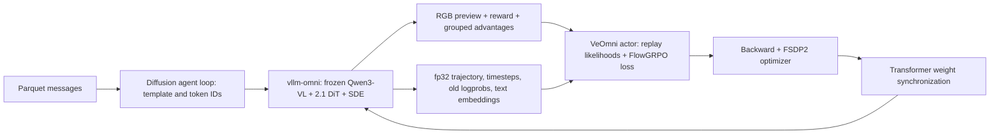

# Qwen-Image-2.1 FlowGRPO with VeOmni

Last updated: 11/12/2026.

This recipe trains the **base Qwen-Image-2.1 transformer, full weights, on GPU for text-to-image**.
The text encoder and VAE remain frozen. It uses the v1 synchronous policy-gradient trainer,
VeOmni FSDP2 for the actor/reference, and the pinned vllm-omni Qwen-Image-2.1 pipeline for rollout.
GPU end-to-end validation is still required; the CPU checks do not establish convergence or GPU memory requirements.

## Connect a local VeOmni checkout

Use the `zpl1n/qwen-image-21-adaptation` branch from
[zpl1n/VeOmni](https://github.com/zpl1n/VeOmni/tree/zpl1n/qwen-image-21-adaptation).
Install both repositories into the **same Linux GPU Python environment**. VeOmni is an imported
Python training backend, not a separate service. Each Ray node needs the same checkout and dependencies.

After installing the pinned verl-omni GPU environment following
[the installation guide](../../../docs/start/install.md):

```bash
export VEOMNI_DIR=/path/to/VeOmni
git -C "$VEOMNI_DIR" branch --show-current
uv pip install --no-deps -e "$VEOMNI_DIR"
python3 -c 'import veomni; print(veomni.__file__)'
python3 -c 'from veomni.models.diffusers.qwen_image21.qwen_image21_transformer.modeling_qwen_image21_transformer import QwenImage21Transformer2DModel; print(QwenImage21Transformer2DModel)'
```

The checkout must already have its required Python dependencies available. `--no-deps` preserves
the Torch/vLLM versions in the training environment; see
[VeOmni dependency compatibility](../../../docs/start/engine_backends.md#installing-veomni-alongside-vllm).
Do not substitute the stock `veomni==0.1.12` package for the adapted branch when running this model.
The engine supports the branch's `VeOmniModelRuntime` layout while retaining the legacy trainer API path
for existing models.

## Checkpoint and data

`MODEL_PATH` must name a local **base**, non-Turbo diffusers checkpoint with:

```text
model_index.json          # _class_name: QwenImage21Pipeline
transformer/              # QwenImage21Transformer2DModel, base model weights
scheduler/
processor/                # Qwen3-VL processor, tokenizer and chat template
text_encoder/             # Qwen3-VL
vae/                      # AutoencoderKLQwenImage21
```

The tokenizer lives under `processor/`. The launch script sets `model.tokenizer_path` accordingly
and supplies `prompt_template.jinja`. The template renders one user message with the 2.1 system
instruction, replacing any old Qwen-Image system instruction in the dataset. This preserves the
checkpoint's exact text template while tokenization stays in the diffusion agent loop.

Existing text-only parquet datasets can be reused: `prompt` contains one user message and an optional
system message; `reward_model`, `data_source`, and `extra_info` follow the selected reward scorer's contract.
For OCR data, use the existing preprocessor:

```bash
python3 examples/flowgrpo_trainer/data_process/qwenimage_ocr.py \
  --input_dir /path/to/raw/ocr --output_dir /path/to/data/qwen_image_21
```

## Run

Run from the verl-omni repository root. The default JPEG-compressibility reward is a lightweight
integration check, not an image-quality or OCR training objective. Select the reward and matching
dataset for the intended experiment.

```bash
export MODEL_PATH=/path/to/Qwen-Image-2.1
export TRAIN_FILES=/path/to/data/train.parquet
export VAL_FILES=/path/to/data/test.parquet
export NUM_GPUS=4
bash examples/flowgrpo_trainer/qwen_image_21/run_qwen_image_21_veomni.sh
```

For the existing OCR model reward, add these overrides (and use OCR parquet data):

```bash
REWARD_FUNCTION_PATH=verl_omni/utils/reward_score/genrm_ocr.py \
REWARD_FUNCTION_NAME=compute_score_ocr \
bash examples/flowgrpo_trainer/qwen_image_21/run_qwen_image_21_veomni.sh \
  reward.reward_model.enable=true \
  reward.reward_model.model_path=Qwen/Qwen3-VL-8B-Instruct \
  reward.reward_model.rollout.name=vllm \
  reward.reward_model.rollout.tensor_model_parallel_size=4
```

Keep `MODEL_PATH`, `TRAIN_FILES`, `VAL_FILES`, and `NUM_GPUS` exported for the second command.
Shell arguments at the end override recipe defaults. `NUM_GPUS` is the total GPU count;
it must be divisible by `NUM_NODES`. This is a starting configuration, not a measured memory guarantee.

## Training path



The rollout and actor adapters register as `(QwenImage21Pipeline, flow_grpo)`. They share a schedule
based on the unpatched `(H/16) × (W/16)` latent grid. Each target image slot in `img_mask` represents
four latent tokens. Prompt features come from Qwen3-VL **before its final normalization**, with system
tokens removed. Replay unpads each prompt before joint RoPE, then uses the target-image prediction
and the stored next latent to recompute log probabilities. The existing FlowGRPO loss, reward loop,
and weight-transfer mechanism remain the training path.

The VAE emits RGBA; this T2I recipe exposes its RGB channels to rewards and previews. Native latents
are preserved for replay. No denoising KV cache is used, so rollout and training both recompute the
transformer prediction at each step.

First-version constraints: `true_cfg_scale=1`, resolutions divisible by 32, Ulysses/SP=1,
full weights, no Turbo/custom sigma grids, no image editing, no step execution, and no prompt cache.
Use `rollout.n` for multiple samples; each engine request produces one image. Micro-batches default
to one; larger training batches are replayed row by row to preserve each prompt's token geometry.

Checkpoint publishing uses the existing [model merger](../../../docs/start/model_merger.md).
The architecture registry includes `QwenImage21Pipeline`; native VeOmni config metadata is accepted
without relaxing transformer geometry or weight-schema checks. Run publishing on Linux: the merger's
atomic output-directory publication requires `renameat2`.

## Validation

CPU adapter/runtime checks, with the project dependencies and adapted VeOmni installed:

```bash
TORCH_COMPILE_DISABLE=1 TORCHINDUCTOR_DISABLE=1 pytest -q \
  tests/pipelines/test_qwen_image_21_flow_grpo_on_cpu.py \
  tests/workers/test_veomni_diffusion_runtime_on_cpu.py
```

The Windows development checks used an isolated import bootstrap for unavailable vLLM serving
dependencies. They covered real VeOmni/Diffusers transformer output and gradients, replay
likelihoods, native config serialization, and tiny pipeline save/reload. The full serving stack,
distributed checkpoint merge, and GPU training still need validation in the Linux environment.

GPU smoke (builds a tiny random checkpoint locally; does not download model weights):

```bash
NUM_GPUS=4 bash tests/special_e2e/run_flowgrpo_qwen_image_21_veomni.sh
```

The smoke runs two training steps with a rule reward and a reference model, covering actor/ref
initialization, rollout trajectories, replay, backward/optimizer, and the following rollout's weight update.
It is also registered in the diffusion GPU smoke runner behind `QWEN_IMAGE_21_VEOMNI_SMOKE=1`,
because the released VeOmni dependency does not contain this adaptation. Install the branch above
before enabling that entry.
